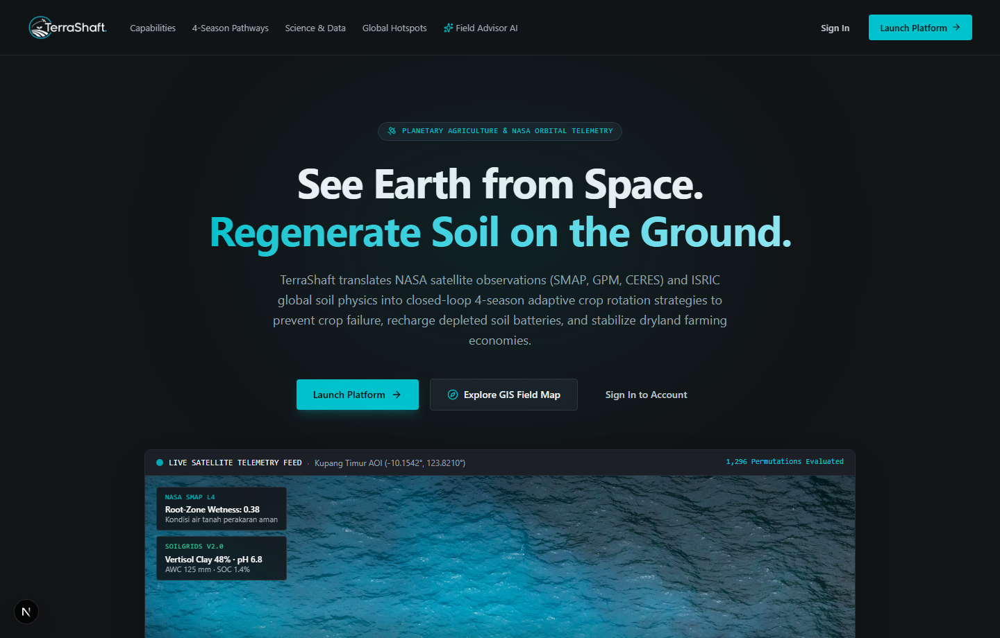
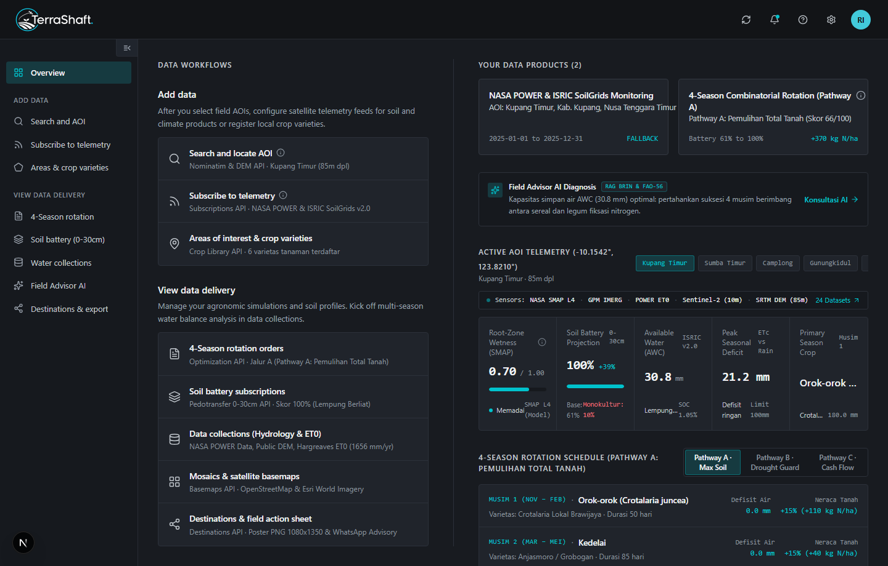
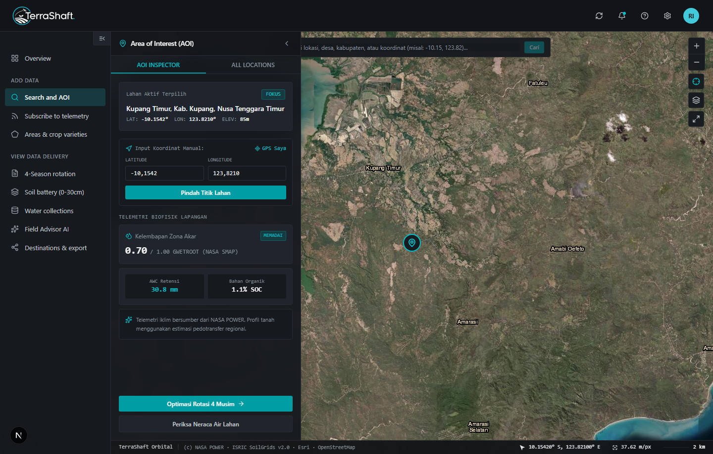
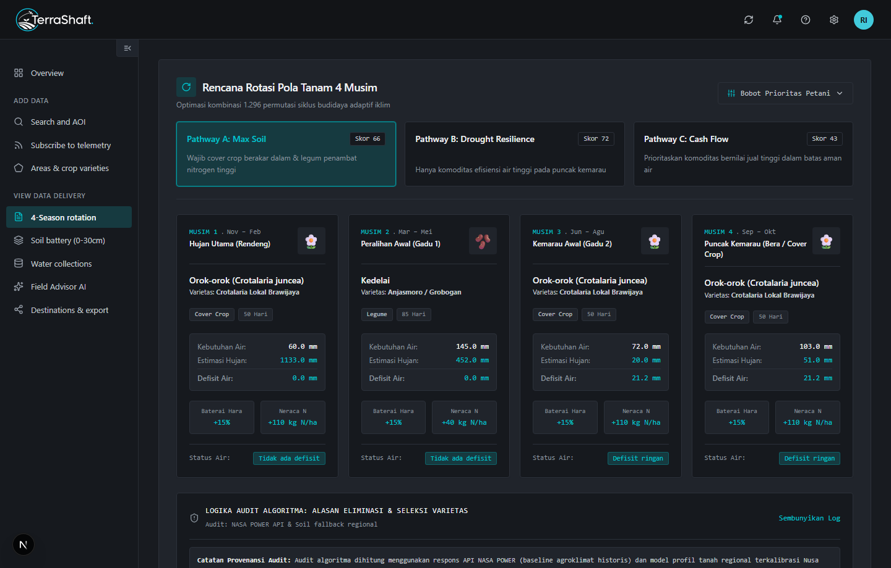
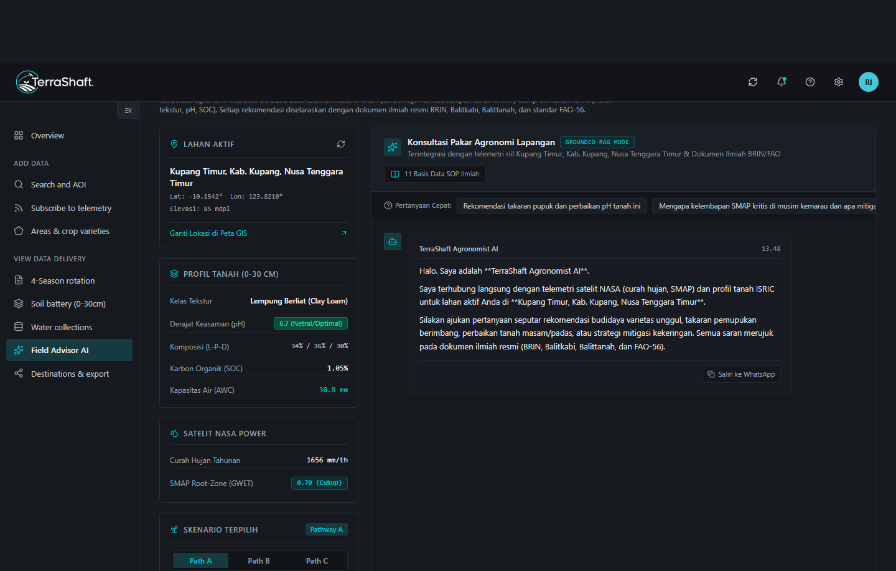
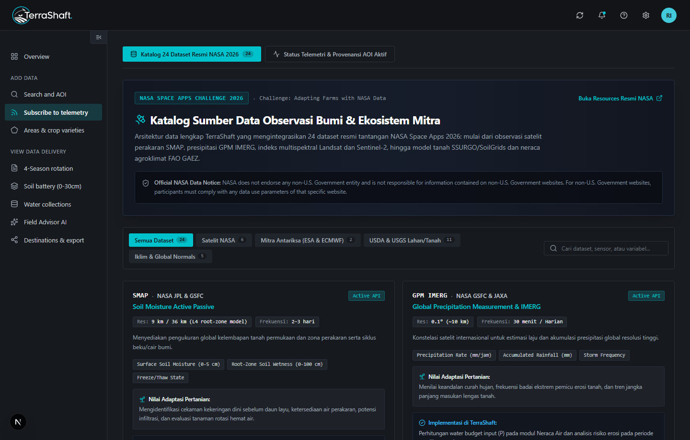

<div align="center">

[](./README.md)
[](./README.en.md)

</div>

# TerraShaft (TerraRotate)

**Adaptive Crop Rotation & Soil Regeneration Decision-Support Engine**

TerraShaft is a web application designed to help farmers and Agricultural Extension Officers (*Penyuluh Pertanian Lapangan* / PPL) build adaptive crop rotation scenarios based on satellite observations, weather data, soil moisture, topography, soil characteristics, and local agricultural context.

The system transforms complex geospatial data into easy-to-understand crop rotation recommendations, complete with water requirement estimates, soil health indicators, drought risk assessments, crop alternatives, and the scientific rationale behind each recommendation.

> **Important Note:** TerraShaft is a decision-support system. It does not replace direct in-situ soil measurements, agricultural extension officers, agronomists, or farmer judgment. Values such as water demand, nitrogen contribution, and the Soil Battery Index are model estimates that carry underlying assumptions and uncertainties.

---

## Table of Contents

- [Application Screenshots](#application-screenshots)
- [Background](#background)
- [Solution](#solution)
- [13 Integrated Datasets & Their Actual System Roles](#13-integrated-datasets--their-actual-system-roles)
- [Geographic Coverage and Dataset Strategy](#geographic-coverage-and-dataset-strategy)
- [System Workflow](#system-workflow)
- [Key Features](#key-features)
- [Methodology and Assumptions](#methodology-and-assumptions)
- [Data Provenance](#data-provenance)
- [Technology Architecture](#technology-architecture)
- [Limitations](#limitations)
- [Running the Project](#running-the-project)
- [Citations and Data Sources](#citations-and-data-sources)
- [Team](#team)
- [License](#license)

---

## Application Screenshots

### 1. Landing Page (`/landing`)

*Introduction to the TerraShaft geospatial intelligence platform bridging NASA Earth observations with dryland crop rotation planning.*

### 2. Executive Overview & Satellite Telemetry Dashboard (`/overview`)

*Real-time telemetry summary for the active location (SMAP `GWETROOT` root-zone soil wetness, GPM `PRECTOTCORR` precipitation, ISRIC SoilGrids v2.0 texture fractions, Available Water Capacity $AWC$, and 3-pathway rotation comparison).*

### 3. Interactive GIS Field Explorer (`/field-map`)

*Leaflet-based spatial explorer featuring high-resolution satellite imagery, Indonesian dryland & global reference presets, location search, and plot boundary inspection.*

### 4. 4-Season Crop Rotation Planner & Radar Comparison (`/rotation-planner`)

*Combinatorial evaluation of $6^4 = 1,296$ rotation sequences across three optimization pathways (Pathway A: Soil Regeneration, Pathway B: Drought Resilience, Pathway C: Cash-Flow Optimized) with full Algorithmic Audit Logs.*

### 5. RAG-Powered AI Field Advisor (`/field-advisor`)

*Contextual agronomic assistant combining active field telemetry with curated scientific knowledge bases (BRIN, Balittanah, Ministry of Agriculture, FAO-56) and explicit citations.*

### 6. Data Provenance Transparency & Scientific Resource Catalog (`/data-sources`)

*Transparent API provenance tracking (`source`, `fetchedAt`, `observationPeriod`, cache/fallback state) alongside a structured catalog of 13 Earth observation datasets and their exact integration roles.*

---

## Background

Agriculture in dryland regions and rainfed food-production centers faces several critical challenges:

- Shifting rainfall patterns make historical planting calendars increasingly difficult to rely on without adjustment.
- Monoculture farming can accelerate nutrient depletion, pest and disease pressure, and vulnerability to water stress.
- Surface soil conditions do not always reflect the moisture available around the root zone.
- Satellite, climate, and soil datasets are available in massive volumes but are difficult to translate into actionable field decisions.
- Agronomic recommendations must simultaneously account for technical factors, economics, water availability, and local conditions.

TerraShaft is designed to bridge Earth observation data with practical, understandable agricultural action.

---

## Solution

TerraShaft combines four analytical layers:

1. **Land observation:** vegetation condition, land-cover context, root-zone soil moisture, and surface thermal context.
2. **Environmental conditions:** precipitation, temperature, solar radiation, reference evapotranspiration ($ET_0$), and site elevation.
3. **Soil and agricultural context:** soil texture fractions (sand, silt, clay), pH, soil organic carbon ($SOC$), cation exchange capacity ($CEC$), available water capacity ($AWC$), and local crop variety profiles.
4. **Decision optimization:** crop filtering based on water constraints, 4-period planting calendars, soil regeneration goals, and estimated net revenue.

The final output presents three ranked rotation pathways (Pathway A, B, and C) rather than a single rigid answer. Each scenario highlights benefits, risks, algorithmic audit logs, model assumptions, and data provenance.

---

## 13 Integrated Datasets & Their Actual System Roles

To uphold scientific rigor and avoid overclaiming, TerraShaft explicitly categorizes its 13 core datasets by their **actual implementation role in the codebase**:

### A. Live API & Core Telemetry (Fetched Directly via Backend Routes)

1. **NASA POWER:** Daily agroclimatology variables (min/max/mean temperature `T2M_MIN`, `T2M_MAX`, `T2M` and surface shortwave solar radiation `ALLSKY_SFC_SW_DWN`) fetched via live API (`/api/nasa-climate`) to compute daily reference evapotranspiration ($ET_0$ using the radiation-calibrated Hargreaves-Samani method aligned with FAO-56).
2. **NASA SMAP (Level-4):** Root-zone soil wetness estimates (`GWETROOT` 0–100 cm assimilated via the NASA POWER endpoint) driving the Soil Battery moisture reserve calculation and early drought warning threshold ($GWETROOT < 0.25$).
3. **ISRIC SoilGrids v2.0:** Soil texture fractions (`sand`, `silt`, `clay`), organic carbon (`soc`), `phh2o`, and `cec` across 0–5 cm, 5–15 cm, and 15–30 cm depth layers (depth-weighted to 0–30 cm) fetched via live REST API (`/api/soil-profile`) to compute Available Water Capacity ($AWC$).
4. **NASA GPM / IMERG:** Daily and monthly precipitation accumulation (via bias-corrected `PRECTOTCORR` in NASA POWER) used for water balance supply calculations and seasonal water-deficit detection.

### B. Spatial GIS References & Satellite Bio-Model Calibration

5. **NASA SRTM / Copernicus DEM:** Automated coordinate elevation lookup via `/api/geocode` (Open-Meteo Elevation API backed by SRTM/Copernicus DEM) alongside topographic context for erosion-control cover crop recommendations.
6. **Landsat & MODIS / VIIRS:** Surface reflectance and vegetation index (NDVI/EVI) reference frameworks used to calibrate crop growth stages, crop coefficients ($K_c$), and bare-fallow windows in the GIS Explorer.
7. **Copernicus Sentinel-2 (ESA):** High-resolution (10 m) optical reference accompanying satellite basemaps in the GIS Explorer for visual plot boundary (*Area of Interest* / AOI) delineation.
8. **GLDAS & ECMWF ERA5:** Land-surface assimilation and continuous atmospheric reanalysis frameworks underpinning multi-layer soil moisture and meteorological time-series continuity.

### C. Indonesian Dryland Enhancement (RAG Knowledge Base & Local Parameters)

9. **NASA ECOSTRESS (JPL):** Knowledge-base indicators for Land Surface Temperature (LST) and canopy thermal stress, supporting soil-cooling cover crop recommendations in semi-arid Indonesian regions (East Nusa Tenggara, Madura, Gunungkidul).
10. **NASA GEDI (LiDAR):** Canopy vertical structure and biomass reference knowledge for integrating windbreak shade trees (*agroforestry*).
11. **BRIN / Balittanah / Ministry of Agriculture Research:** Curated RAG knowledge base (`agronomyKnowledgeBase.ts`) and local adaptive cultivar parameters (`crops_library.json`: Bioguma Sorghum, Anjasmoro Soybean, Vima Mungbean, Bisi-18 Hybrid Maize, Inpago Upland Rice, *Crotalaria juncea* Sunn Hemp, and acid-soil Dolomite liming) powering the AI Field Advisor & rotation engine.
12. **FAO GAEZ v4 & FAO-56:** Agro-climatic crop suitability bounds, phenological crop coefficients ($K_c$), and water-balance validation rules in the 4-season optimization engine.

### D. Pedological Calibration Standards

13. **USDA NRCS (Soil Taxonomy & SSURGO/STATSGO2):** Empirical **USDA Soil Texture Triangle** classification rules (`classifySoilTexture`) and texture–water retention relationships underlying the pedotransfer calculation of Available Water Capacity ($AWC$) and regional soil reference profiles.

---

## Geographic Coverage and Dataset Strategy

TerraShaft implements a **Global Core + Regional Context** architecture.

### Global Core (Active Worldwide)

Primary live telemetry providers operating across Indonesia and global coordinates:

```text
NASA POWER (T2M, T2M_MAX, T2M_MIN, ALLSKY_SFC_SW_DWN)
NASA SMAP L4 (GWETROOT 0-100cm via NASA POWER)
NASA GPM / IMERG (PRECTOTCORR via NASA POWER)
ISRIC SoilGrids 250m v2.0 (Sand, Silt, Clay, SOC, pH, CEC 0-30cm)
OpenStreetMap Nominatim (Reverse & Forward Geocoding via /api/geocode)
```

### Indonesian Regional Context

Enriched with local seed variety profiles, dryland presets across Indonesia (East Kupang, Camplong, East Sumba, Gunungkidul, Indramayu, East Lombok), and curated BRIN/Balittanah/Kementan agronomic guidelines inside the RAG Field Advisor.

### International Reference Context

Includes cross-continental agro-climatic presets (Central Valley USA, Machakos Kenya, Murray-Darling Australia) and a transparent 13-dataset scientific resource catalog (NASA, ESA, ECMWF, ISRIC, USDA, FAO, BRIN/Kementan) at `/data-sources`.

---

## System Workflow

```text
Coordinate input / place search / preset selection on map
              ↓
Strict coordinate validation (-90..90 lat, -180..180 lon without silent clamping)
              ↓
Parallel telemetry fetching via Next.js Route Handler proxies:
  • /api/nasa-climate (NASA POWER, SMAP GWETROOT, GPM PRECTOTCORR)
  • /api/soil-profile (ISRIC SoilGrids v2.0 0–30 cm)
              ↓
Quality control, fill-value masking (-999), & calibrated regional fallback on timeout
              ↓
Computing daily ET0 (Hargreaves-Samani), crop ETc, soil AWC, & Water Balance
              ↓
Combinatorial evaluation of 6^4 = 1,296 4-period rotation sequences
              ↓
Ranking 3 primary decision pathways:
  • Pathway A (Max Soil Regeneration)
  • Pathway B (Drought Resilience)
  • Pathway C (Cash-Flow Optimized)
              ↓
Generating Algorithmic Audit Logs, Provenance Badges, RAG Field Advisory, & PNG Action Sheet
```

---

## Key Features

### 1. Interactive GIS Map & Dynamic Location Input (`/field-map` & Header)

- Place name search and reverse geocoding (`/api/geocode`).
- Manual GPS coordinate input and interactive Leaflet map pin selection.
- Device geolocation support.
- Built-in presets for Indonesian drylands and global agricultural basins.
- Strict coordinate bounds validation (`-90..90` latitude, `-180..180` longitude) returning HTTP 400 on invalid inputs without silent clamping.

### 2. Multi-Source Satellite & Soil Telemetry (`/overview`)

Integrates root-zone soil wetness, monthly precipitation, temperature, solar radiation, and topsoil physico-chemical properties (USDA texture class, SOC, pH, CEC, AWC) with full provenance metadata.

### 3. Soil Battery Index (`/soil-battery`)

The Soil Battery is a composite heuristic index ($0–100\%$) designed to communicate simulated soil health dynamics and biological nitrogen balance ($\Delta N$ in $\text{kg N/ha}$), not a replacement for laboratory soil testing:

- **Discharging:** Consecutive nutrient-demanding cereal monocultures deplete the Soil Battery score.
- **Charging:** Incorporating nitrogen-fixing legumes (Anjasmoro Soybean, Vima Mungbean) and hardpan-penetrating cover crops (*Crotalaria juncea*) recharges the Soil Battery index.

### 4. Three Optimal Rotation Scenarios (`/rotation-planner`)

- **Pathway A — Soil Regeneration:** Maximizes Soil Battery recovery, biological nitrogen fixation, and organic biomass return.
- **Pathway B — Drought Resilience:** Disqualifies water-intensive crops during severe deficit windows and prioritizes drought-tolerant cultivars (e.g., Bioguma Sorghum, Vima Mungbean).
- **Pathway C — Cash-Flow Optimized:** Maximizes projected net farm revenue while enforcing root-zone water safety constraints.

### 5. Water Balance Chart (`/water-balance`)

Monthly dual-axis comparison between GPM precipitation supply (`PRECTOTCORR`), SMAP root-zone moisture wetness (`GWETROOT`), and crop evapotranspiration demand ($ET_c = ET_0 \times K_c$).

### 6. Algorithmic Audit Log

Every recommendation transparently exposes why specific crops were selected or disqualified based on biophysical threshold rules (e.g., $W_{deficit}$ limits or monoculture pest penalties).

### 7. RAG-Powered AI Field Advisor (`/field-advisor`)

Interactive agronomic assistant (`/api/ai/advisor`) combining document retrieval from `agronomyKnowledgeBase.ts` with live field telemetry. Supports user-configured Gemini API keys (via `/settings`) as well as a built-in deterministic offline-capable advisory engine with explicit scientific citations.

### 8. WhatsApp Action Sheet Export (`/action-sheet`)

Renders the 4-season rotation plan into a high-resolution mobile-friendly PNG poster ($1080 \times 1350\text{ px}$) via `html-to-image`, paired with a **High-Contrast Outdoor Mode** for readability under direct sunlight.

---

## Methodology and Assumptions

### 1. Reference Evapotranspiration ($ET_0$)

Computed in `src/lib/evapotranspiration.ts` using the **radiation-calibrated Hargreaves-Samani equation** driven by NASA POWER surface shortwave radiation (`ALLSKY_SFC_SW_DWN`):

```text
Ra_equiv (mm/day) = ALLSKY_SFC_SW_DWN × 0.408
ET0 (mm/day)      = 0.0023 × Ra_equiv × (Tmean + 17.8) × sqrt(max(0.5, Tmax - Tmin))
```

### 2. Crop Water Requirement ($ET_c$)

```text
ETc = Daily_ET0 × Growth_Duration_Days × (Kc_mid × 0.88)
```

### 3. Available Water Capacity ($AWC$) & USDA Texture

Computed in `src/lib/pedotransfer.ts` for the 0–30 cm topsoil layer from ISRIC SoilGrids v2.0 particle-size fractions and Soil Organic Carbon ($SOC$):

```text
AWC (mm / 30cm) = 0.15 × Sand% + 0.35 × Silt% + 0.40 × Clay% + 1.2 × SOC%
```

### 4. Economic & Nitrogen Balance Estimates

Projected net revenue and biological nitrogen contributions ($\text{kg N/ha}$) in `src/lib/optimizationEngine.ts` are model simulations parameterized by `src/data/crops_library.json` and should be calibrated with local market prices and field observations.

---

## Data Provenance

Every backend proxy response (`/api/nasa-climate` and `/api/soil-profile`) embeds a strict provenance metadata contract distinguishing live API observations, cached responses, and calibrated regional failovers:

```json
{
  "source": "ISRIC_SOILGRIDS_LIVE",
  "fetchedAt": "2026-11-15T06:00:00.000Z",
  "observationPeriod": "Standard Depth Layer 0-30cm",
  "cached": false,
  "fallbackReason": null
}
```

Supported `source` identifiers in the codebase:

- `NASA_POWER_LIVE` — Live response from the NASA POWER Agroclimatology API.
- `ISRIC_SOILGRIDS_LIVE` — Live response from the ISRIC SoilGrids v2.0 REST API.
- `FALLBACK_CLIMATOLOGY` — Latitude-calibrated regional climatology baseline used when the upstream NASA POWER API times out or is unreachable.
- `REGIONAL_FALLBACK` — Calibrated regional pedological profile used when ISRIC SoilGrids is unreachable or returns masked water/urban pixels.

`fetchedAt` records the network/cache retrieval timestamp and is strictly separated from `observationPeriod` (the physical satellite observation window or soil depth horizon).

---

## Technology Architecture

- **Frontend Framework:** Next.js 16 (App Router, React 19, TypeScript).
- **Styling:** Tailwind CSS v4 (Dark Telemetry Theme & High-Contrast Outdoor Mode).
- **Internationalization (i18n):** `i18next` for synchronized bilingual documentation (`README.md` & `README.en.md`).
- **Spatial Mapping:** Leaflet with satellite imagery and dark vector basemaps.
- **Data Visualization:** Recharts (Dual-Axis Water Balance Chart & 5-Axis Pathway Radar Comparison).
- **State Management & Offline Persistence:** Zustand + `idb-keyval` + PWA Service Worker.
- **Image Export:** `html-to-image` (client-side $1080 \times 1350\text{ px}$ PNG poster rendering).
- **Backend API Route Handlers:**
  - `/api/nasa-climate` — NASA POWER Agroclimatology proxy with bounded in-memory caching (24h TTL) & regional climatology failover.
  - `/api/soil-profile` — ISRIC SoilGrids v2.0 proxy with 0–30 cm depth-weighted aggregation, bounded caching (30d TTL), & regional soil failover.
  - `/api/geocode` — OpenStreetMap Nominatim forward & reverse geocoding proxy.
  - `/api/ai/advisor` — RAG Field Advisor endpoint supporting both Gemini API keys and a deterministic local citation engine.

---

## Limitations

- Spatial resolutions of NASA POWER (~50 km) and SMAP L4 (~9–36 km) reflect regional grid conditions rather than sub-meter in-situ soil probes.
- ISRIC SoilGrids (250 m resolution) is a global machine-learning prediction and does not replace laboratory soil testing.
- Partner datasets in the resource catalog (SRTM, Sentinel-2, ECOSTRESS, GEDI, SSURGO) serve as GIS spatial context, bio-model calibration references, and RAG knowledge bases—the browser does not process raw spectral satellite bands directly.
- Crop water demand ($ET_c$), Soil Battery scores, nitrogen balances, and financial projections are simulation estimates that must be validated with local extension officers (PPL) or agronomists.

---

## Running the Project

### Prerequisites

- Node.js 20 or newer.
- npm, pnpm, or yarn.

### Installation

```bash
git clone https://github.com/vellumgracia-del/TerraShaft.git
cd TerraShaft
npm install
```

### Environment Variables (Optional)

The application runs out of the box without secret API keys because NASA POWER and ISRIC SoilGrids are open public APIs. To customize upstream timeouts/URLs or configure a server-side Gemini API key for the Field Advisor, create a `.env.local` file:

```text
NASA_POWER_BASE_URL=https://power.larc.nasa.gov/api
ISRIC_SOILGRIDS_BASE_URL=https://rest.isric.org/soilgrids/v2.0
NASA_POWER_TIMEOUT_MS=8000
SOILGRIDS_TIMEOUT_MS=8000
GEMINI_API_KEY=<optional-for-ai-advisor>
```

Never commit `.env.local` or secret keys to version control.

### Running Tests and Development Server

```bash
npm test
npm run lint
npm run dev
```

Open `http://localhost:3000` in your browser.

### Synchronizing Bilingual Documentation (`i18next`)

```bash
npm run i18n:readme
```

### Production Build

```bash
npm run build
npm run start
```

---

## Citations and Data Sources

- **NASA POWER Project:** NASA Langley Research Center (LaRC) Agroclimatology Archive (`T2M`, `ALLSKY_SFC_SW_DWN`, `PRECTOTCORR`, `GWETROOT`).
- **NASA SMAP:** Soil Moisture Active Passive Level-4 Root-Zone Soil Moisture.
- **NASA GPM IMERG:** Integrated Multi-satellitE Retrievals for GPM.
- **ISRIC — World Soil Information:** SoilGrids 250m v2.0 (*Poggio et al., 2021*).
- **FAO Irrigation and Drainage Paper No. 56:** *Crop Evapotranspiration — Guidelines for Computing Crop Water Requirements* (*Allen et al., 1998*).
- **FAO GAEZ v4:** Global Agro-Ecological Zones data portal.
- **BRIN, Balittanah & Ministry of Agriculture (Indonesia):** Technical monographs on dryland palawija/cereal cultivars and acid-soil amelioration.
- **USDA NRCS:** Soil Survey Manual & Soil Texture Triangle classification standard.

---

## Team

- **Zulfa Fahmiy Al Murtadlo** ([@varosaghasi](https://github.com/varosaghasi)) — Team Owner
- **Mohammad Arga** ([@rifaldhi](https://github.com/rifaldhi))
- **Moch. Hafidz Zawawi** ([@zawacaprio](https://github.com/zawacaprio))
- **Stiven Josh Peter Siburian** ([@stevenjoshburian](https://github.com/stevenjoshburian))
- **Ravi Arnan Irianto** ([@raviarnan](https://github.com/raviarnan))

---

## License

Developed for sustainable agricultural research, education, and innovation (NASA Space Apps Challenge). Satellite, soil, and agroclimatological data attributions follow the open-access terms of their respective providers (NASA Earthdata, ISRIC SoilGrids CC-BY 4.0, FAO, and BRIN/Kementan).

© 2026 TerraShaft Team — Built for resilient agriculture and space-to-field impact.
