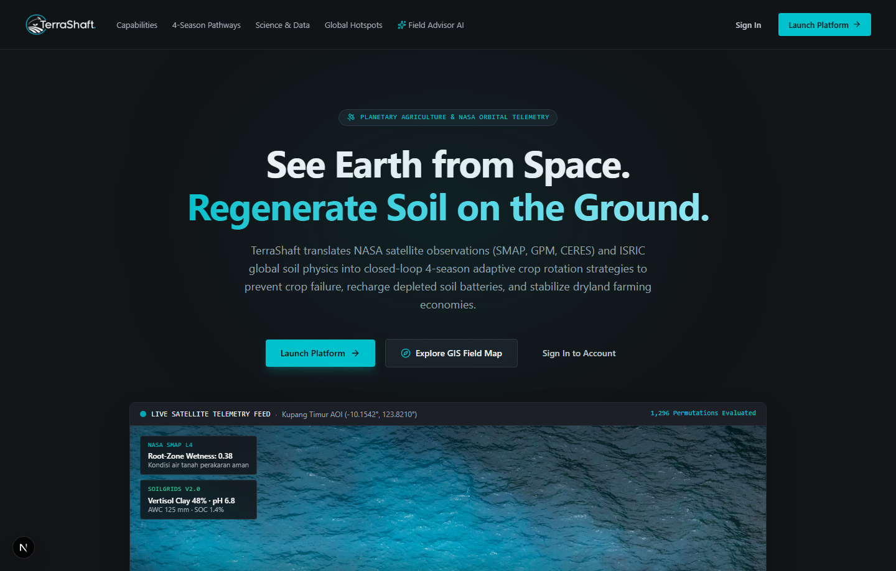
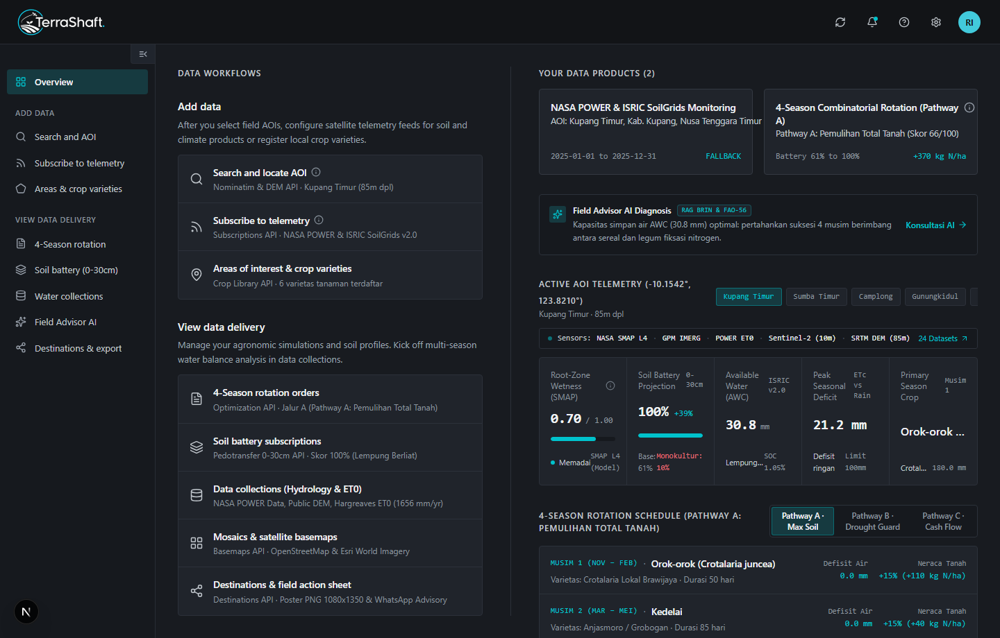
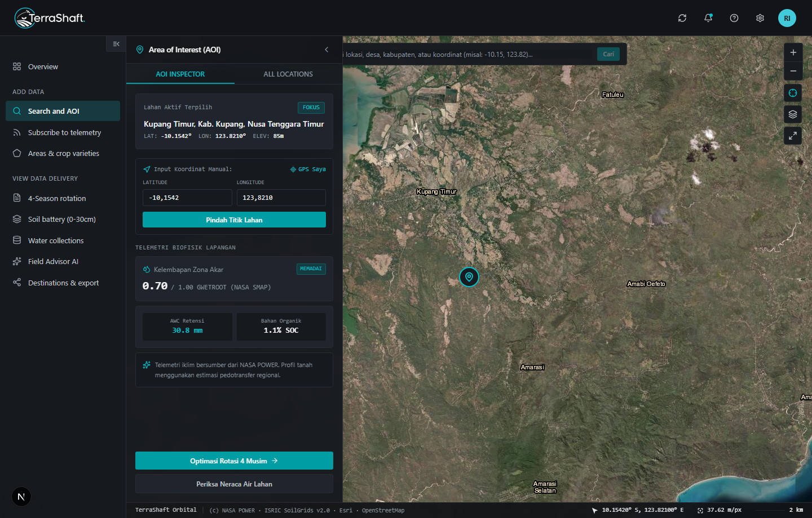
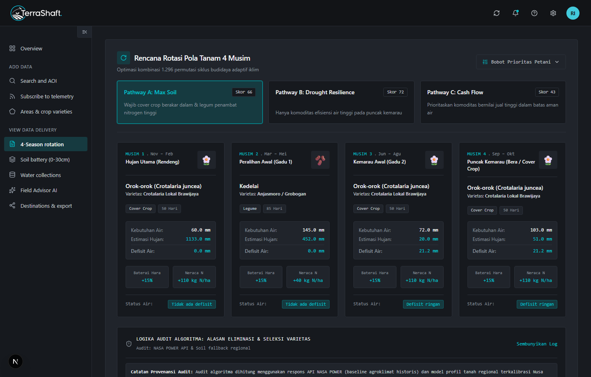
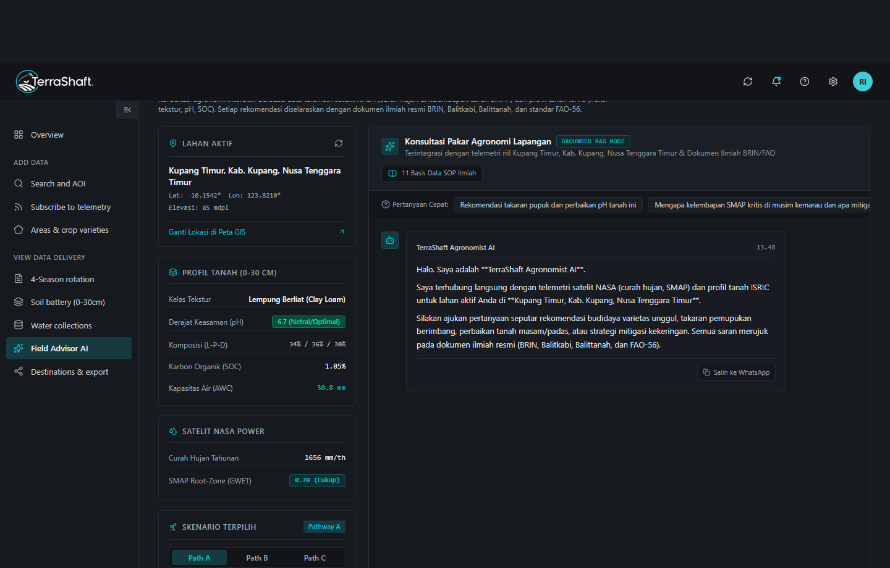
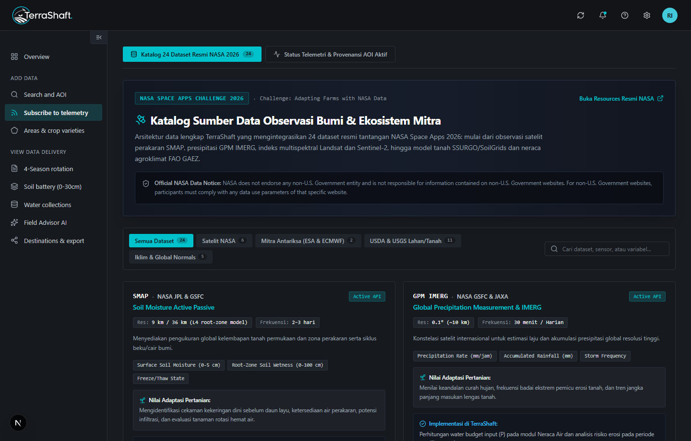

<div align="center">

[](./README.md)
[](./README.id.md)

</div>

# TerraShaft (TerraRotate)

**Adaptive Crop Rotation & Soil Regeneration Decision-Support Engine**

TerraShaft adalah aplikasi web untuk membantu petani dan Penyuluh Pertanian Lapangan (PPL) menyusun skenario rotasi tanaman adaptif berdasarkan observasi satelit, data cuaca, kelembapan tanah, topografi, karakteristik tanah, dan konteks pertanian lokal.

Sistem mengubah data geospasial yang kompleks menjadi rekomendasi rotasi tanaman yang lebih mudah dipahami, dilengkapi estimasi kebutuhan air, indikator kesehatan tanah, risiko kekeringan, alternatif tanaman, serta alasan ilmiah di balik setiap rekomendasi.

> **Catatan penting:** TerraShaft adalah sistem pendukung keputusan. Sistem tidak menggantikan pengukuran tanah langsung, penyuluh, agronom, atau keputusan petani. Nilai seperti kebutuhan air, kontribusi nitrogen, dan indeks Soil Battery merupakan estimasi model yang memiliki asumsi dan ketidakpastian.

---

## Daftar Isi

- [Dokumentasi Tampilan Aplikasi (Screenshots)](#dokumentasi-tampilan-aplikasi-screenshots)
- [Latar Belakang](#latar-belakang)
- [Solusi](#solusi)
- [13 Dataset Terintegrasi & Peran Aktualnya di Sistem](#13-dataset-terintegrasi--peran-aktualnya-di-sistem)
- [Zonasi Agroekologi Global, Lokalisasi Kultivar & i18n](#zonasi-agroekologi-global-lokalisasi-kultivar--i18n)
- [Cakupan Geografis dan Strategi Dataset](#cakupan-geografis-dan-strategi-dataset)
- [Alur Kerja Sistem](#alur-kerja-sistem)
- [Fitur Utama](#fitur-utama)
- [Metodologi dan Asumsi](#metodologi-dan-asumsi)
- [Provenansi Data](#provenansi-data)
- [Arsitektur Teknologi](#arsitektur-teknologi)
- [Keterbatasan](#keterbatasan)
- [Menjalankan Proyek](#menjalankan-proyek)
- [Sitasi dan Sumber Data](#sitasi-dan-sumber-data)
- [Tim](#tim)
- [Lisensi](#lisensi)

---

## Dokumentasi Tampilan Aplikasi (Screenshots)

### 1. Halaman Utama (Landing Page)

*Pengantar platform intelijen geospasial TerraShaft yang menghubungkan observasi satelit NASA dengan perencanaan rotasi tanaman lahan kering.*

### 2. Dashboard Ringkasan Eksekutif & Telemetri Satelit (`/overview`)

*Ringkasan telemetri lokasi aktif (kelembapan zona perakaran SMAP `GWETROOT`, curah hujan GPM `PRECTOTCORR`, tekstur tanah ISRIC SoilGrids v2.0, kapasitas menahan air $AWC$, serta perbandingan 3 jalur rotasi).*

### 3. Peta Eksplorasi Lahan Interaktif (`/field-map`)

*Eksplorasi spasial berbasis Leaflet dengan citra satelit resolusi tinggi, preset lokasi lahan kering Indonesia & global, pencarian wilayah, serta delineasi petak pengamatan.*

### 4. Perencana Rotasi 4 Musim & Komparasi Radar (`/rotation-planner`)

*Evaluasi kombinatorial $6^4 = 1.296$ sekuens rotasi ke dalam tiga skenario utama (Pathway A: Soil Regeneration, Pathway B: Drought Resilience, Pathway C: Cash-Flow Optimized) lengkap dengan Algorithmic Audit Log.*

### 5. Asisten Agronomi AI Berbasis RAG (`/field-advisor`)

*Konsultasi agronomi kontekstual yang mengombinasikan telemetri lokasi aktif dengan basis pengetahuan lokal (BRIN, Balittanah, Kementan, FAO-56) disertai sitasi sumber ilmiah.*

### 6. Transparansi Provenansi Data & Katalog Sumber Ilmiah (`/data-sources`)

*Panel pelacakan provenansi API secara transparan (`source`, `fetchedAt`, `observationPeriod`, status cache/fallback) dan katalog 13 sumber data observasi bumi beserta status integrasinya.*

---

## Latar Belakang

Pertanian di wilayah lahan kering dan sentra pangan tadah hujan menghadapi beberapa tantangan:

- Perubahan pola hujan membuat kalender tanam historis semakin sulit dipakai tanpa penyesuaian.
- Monokultur dapat meningkatkan pengambilan hara, tekanan penyakit, dan kerentanan terhadap stres air.
- Kondisi permukaan tanah tidak selalu menggambarkan kelembapan yang tersedia di sekitar zona perakaran.
- Data satelit, iklim, dan tanah tersedia dalam jumlah besar tetapi sulit diterjemahkan menjadi keputusan lapangan.
- Rekomendasi agronomi perlu mempertimbangkan faktor teknis, ekonomi, ketersediaan air, dan kondisi lokal secara bersamaan.

TerraShaft dirancang untuk menjembatani observasi bumi dengan tindakan pertanian yang lebih mudah dipahami.

---

## Solusi

TerraShaft menggabungkan empat lapisan analisis:

1. **Observasi lahan:** kondisi vegetasi, perubahan tutupan lahan, kelembapan tanah zona perakaran, dan konteks termal permukaan.
2. **Kondisi lingkungan:** curah hujan, temperatur, radiasi matahari, evapotranspirasi acuan ($ET_0$), dan elevasi lokasi.
3. **Kondisi tanah dan pertanian:** fraksi tekstur (pasir, debu, liat), pH, karbon organik ($SOC$), kapasitas tukar kation ($CEC$), kapasitas menahan air ($AWC$), dan pustaka komoditas lokal.
4. **Optimasi keputusan:** penyaringan tanaman berdasarkan batas air, kalender tanam 4 periode, tujuan regenerasi tanah, dan estimasi pendapatan.

Hasil akhirnya berupa beberapa skenario rotasi (Pathway A, B, dan C), bukan satu jawaban mutlak. Setiap skenario menunjukkan manfaat, risiko, alasan ilmiah (*audit log*), asumsi model, dan sumber data yang digunakan.

---

## 13 Dataset Terintegrasi & Peran Aktualnya di Sistem

Untuk menjaga akuntabilitas ilmiah dan menghindari *overclaim*, TerraShaft mengelompokkan sumber data berdasarkan **tingkat integrasi aktual di dalam kode**:

### A. Live API & Telemetri Inti (Dipanggil Langsung di Backend)

1. **NASA POWER:** Data agroklimatologi harian (suhu min/max/rata-rata `T2M_MIN`, `T2M_MAX`, `T2M` dan radiasi surya permukaan `ALLSKY_SFC_SW_DWN`) via *live API* (`/api/nasa-climate`) untuk kalkulasi laju evapotranspirasi acuan harian ($ET_0$ metode Hargreaves-Samani terkalibrasi radiasi mengacu FAO-56).
2. **NASA SMAP (Level-4):** Estimasi lengas tanah zona perakaran (`GWETROOT` kedalaman 0–100 cm yang diasimilasi melalui endpoint NASA POWER) untuk indikator Baterai Tanah dan ambang peringatan dini kekeringan ($GWETROOT < 0.25$).
3. **ISRIC SoilGrids v2.0:** Data fraksi tekstur tanah (pasir `sand`, debu `silt`, liat `clay`), karbon organik (`soc`), `phh2o`, dan `cec` pada kedalaman 0–5 cm, 5–15 cm, dan 15–30 cm (dirata-ratakan tertimbang untuk lapisan 0–30 cm) via *live REST API* (`/api/soil-profile`) untuk menghitung kapasitas menahan air tanah ($AWC$).
4. **NASA GPM / IMERG:** Akumulasi presipitasi harian/bulanan (via parameter terkoreksi `PRECTOTCORR` di NASA POWER) untuk perhitungan input neraca air (*water balance*) dan deteksi defisit air musiman.

### B. Referensi Spasial GIS & Kalibrasi Bio-Model Satelit

5. **NASA SRTM / Copernicus DEM:** Deteksi elevasi titik koordinat lahan secara otomatis via endpoint `/api/geocode` (Open-Meteo Elevation API berbasis SRTM/Copernicus DEM) serta konteks topografi untuk rekomendasi tanaman konservasi penahan erosi.
6. **Landsat & MODIS / VIIRS:** Referensi reflektansi permukaan dan dinamika indeks vegetasi (NDVI/EVI) untuk kalibrasi fase pertanaman, koefisien tanaman ($K_c$), dan identifikasi periode bera pada modul eksplorasi GIS.
7. **Copernicus Sentinel-2 (ESA):** Referensi citra optik resolusi tinggi (10 m) pendamping basemap satelit pada GIS Explorer untuk delineasi visual batas petak lahan (*Area of Interest* / AOI).
8. **GLDAS & ECMWF ERA5:** Model asimilasi daratan dan reanalisis atmosfer kontinu yang menjadi acuan kontinuitas deret waktu cuaca serta profil kelembapan tanah multi-lapisan.

### C. Penguatan Lahan Kering Indonesia (RAG Knowledge Base & Parameter Lokal)

9. **NASA ECOSTRESS (JPL):** Basis pengetahuan indikator suhu permukaan daratan (*Land Surface Temperature*) dan cekaman termal tanaman untuk mendasari rekomendasi *cover crop* penurun suhu tanah di wilayah semi-arid (NTT, Madura, Gunungkidul).
10. **NASA GEDI (LiDAR):** Basis pengetahuan struktur kanopi vertikal dan biomassa untuk panduan integrasi pohon pelindung penahan angin (*agroforestri*).
11. **Riset Agronomi BRIN / Balittanah / Kementan:** Basis data RAG (`agronomyKnowledgeBase.ts`) dan rujukan kultivar nasional Indonesia terlokalisasi (`cultivars_registry.json` khusus wilayah `ID`: Sorgum Bioguma, Kedelai Anjasmoro, Kacang Hijau Vima, Jagung Bisi-18, Padi Gogo Inpago, *Crotalaria juncea*, serta ameliorasi Dolomit tanah masam) pada asisten AI Field Advisor & mesin optimasi rotasi.
12. **FAO GAEZ v4 & FAO-56:** Standar batas toleransi agroklimat tanaman pangan, koefisien tanaman ($K_c$), dan validasi neraca air pada modul optimasi 4 musim.

### D. Standar Kalibrasi Pedologis

13. **USDA NRCS (Soil Taxonomy & SSURGO/STATSGO2):** Standar klasifikasi **Segitiga Tekstur Tanah USDA** (`classifySoilTexture`) dan hubungan empiris tekstur–retensi air yang mendasari fungsi pedotransfer kalkulasi *Available Water Capacity* ($AWC$) serta referensi profil tanah regional.

---

## Zonasi Agroekologi Global, Lokalisasi Kultivar & i18n

TerraShaft memisahkan secara ketat **taksonomi spesies tanaman** dari **kultivar/varietas terverifikasi regional** agar varietas Indonesia tidak pernah terbawa ke negara lain tanpa bukti registrasi:

1. **Pemisahan Entitas Spesies vs Kultivar:** Spesies (`src/data/crop_species.json`) memuat parameter fisiologis generik (*Oryza sativa L.*, *Zea mays L.*, *Glycine max (L.) Merr.*, *Vigna radiata*, *Sorghum bicolor*, *Crotalaria juncea*). Kultivar (`src/data/cultivars_registry.json`) mengikat entitas varietas pada `country_or_region_of_release`, `allowed_agroecological_zones`, `registration_status`, `evidence_source`, dan `confidence_score`.
2. **Pipeline Zonasi Agroekologi Global (`src/lib/agroecologicalZoning.ts`):** Mengonversi koordinat, elevasi, iklim NASA POWER, serta profil tanah ISRIC SoilGrids menjadi profil `AgroecologicalProfile` (negara, makro-wilayah, belahan bumi, sabuk elevasi, bulan kering, GDD, kelas fotoperiod, dan zona agroekologi).
3. **Isolasi Geografis & Fallback Arketipe (`src/lib/cultivarLocalizer.ts`):** Kultivar Indonesia (seperti Inpago, Bisi-18, Anjasmoro, Vima, Bioguma) hanya direkomendasikan di Indonesia (`ID`). Untuk wilayah global seperti `US`, `KE`, `IN`, `BR`, atau `AU`, sistem menampilkan varietas terverifikasi setempat atau melakukan fallback transparan ke **Arketipe Fenotipe Spesies** tanpa halusinasi nama varietas.
4. **Dukungan Dwibahasa i18n (`en` & `id`):** Aplikasi menggunakan `i18next` (`src/locales/en.json` default untuk demo internasional, `src/locales/id.json` alternatif bahasa Indonesia). Pergantian bahasa `EN | ID` hanya mengubah label antarmuka—telemetri, nama ilmiah, nama kultivar, unit metrik, dan hasil optimasi tetap identik.

---

## Cakupan Geografis dan Strategi Dataset

TerraShaft menggunakan pendekatan **Global Core + Regional Context**.

### Global Core (Aktif di Seluruh Dunia)

Fondasi telemetri global yang bekerja untuk Indonesia maupun lokasi internasional:

```text
NASA POWER (T2M, T2M_MAX, T2M_MIN, ALLSKY_SFC_SW_DWN)
NASA SMAP L4 (GWETROOT 0-100cm via NASA POWER)
NASA GPM / IMERG (PRECTOTCORR via NASA POWER)
ISRIC SoilGrids 250m v2.0 (Sand, Silt, Clay, SOC, pH, CEC 0-30cm)
OpenStreetMap Nominatim (Reverse & Forward Geocoding via /api/geocode)
```

### Konteks Regional Indonesia

Dilengkapi dengan pustaka komoditas lokal, preset wilayah lahan kering Indonesia (Kupang Timur, Camplong, Sumba Timur, Gunungkidul, Indramayu, Lombok Timur), dan dokumen referensi agronomi BRIN/Balittanah/Kementan pada modul RAG Field Advisor.

### Konteks Referensi Internasional

Menyediakan preset pengujian lintas zona agroklimat global (seperti Central Valley USA, Machakos Kenya, dan Murray-Darling Australia) serta katalog referensi dataset mitra internasional (USDA, USGS, ESA, ECMWF, FAO) di halaman `/data-sources`.

---

## Alur Kerja Sistem

```text
Input koordinat / pencarian wilayah / pilih preset di peta
              ↓
Validasi koordinat ketat (-90..90 lat, -180..180 lon tanpa silent clamping)
              ↓
Pengambilan data paralel via Proxy Route Handlers:
  • /api/nasa-climate (NASA POWER, SMAP GWETROOT, GPM PRECTOTCORR)
  • /api/soil-profile (ISRIC SoilGrids v2.0 0–30 cm)
              ↓
Quality control, masking nilai fill (-999), & fallback regional jika API hulu timeout
              ↓
Perhitungan ET0 harian (Hargreaves-Samani), ETc tanaman, AWC tanah, & Water Balance
              ↓
Evaluasi kombinatorial 6^4 = 1.296 skenario rotasi 4 periode
              ↓
Pemeringkatan 3 jalur utama:
  • Pathway A (Max Soil Regeneration)
  • Pathway B (Drought Resilience)
  • Pathway C (Cash-Flow Optimized)
              ↓
Penyusunan Algorithmic Audit Log, Provenance Badge, AI Field Advisor, & Action Sheet PNG
```

---

## Fitur Utama

### 1. Peta GIS & Input Lokasi Dinamis (`/field-map` & Header)

- Pencarian lokasi melalui nama wilayah (`/api/geocode`).
- Input koordinat manual dan klik langsung pada peta interaktif Leaflet.
- Deteksi geolokasi perangkat pengguna.
- Preset wilayah lahan kering Indonesia dan lokasi referensi global.
- Validasi ketat latitude `-90..90` dan longitude `-180..180` (mengembalikan HTTP 400 tanpa *silent clamping*).

### 2. Multi-Source Satellite & Soil Telemetry (`/overview`)

Menggabungkan data kelembapan tanah zona perakaran, curah hujan bulanan, suhu, radiasi matahari, serta fisika-kimia tanah (tekstur USDA, SOC, pH, CEC, AWC) lengkap dengan metadata provenansi.

### 3. Soil Battery Index (`/soil-battery`)

Soil Battery adalah indeks komposit ($0–100\%$) untuk memvisualisasikan simulasi dinamika kesehatan tanah dan neraca nitrogen alami ($\Delta N$ dalam $\text{kg N/ha}$), bukan pengganti uji laboratorium tanah:

- **Discharging:** Penanaman sereal rakus hara secara berturut-turut menurunkan kapasitas indeks baterai tanah.
- **Charging:** Penyisipan spesies legum penambat nitrogen (*Glycine max*, *Vigna radiata*) dan *cover crop* pemecah padas (*Crotalaria juncea*) dengan kultivar terlokalisasi memulihkan skor indeks baterai tanah.

### 4. Tiga Skenario Rotasi Optimal (`/rotation-planner`)

- **Pathway A — Soil Regeneration:** Memprioritaskan pemulihan indeks baterai tanah, fiksasi nitrogen biologis, dan biomassa penutup tanah.
- **Pathway B — Drought Resilience:** Memblokir tanaman boros air pada periode defisit air tinggi dan memprioritaskan spesies tahan kering dengan kultivar terlokalisasi (atau arketipe fenotipe spesies).
- **Pathway C — Cash-Flow Optimized:** Memprioritaskan estimasi pendapatan bersih dengan tetap menjaga batas aman ketersediaan air tanah.

### 5. Water Balance Chart (`/water-balance`)

Grafik komparasi bulanan antara suplai curah hujan GPM (`PRECTOTCORR`), cadangan lengas perakaran SMAP (`GWETROOT`), dan kebutuhan evapotranspirasi tanaman ($ET_c = ET_0 \times K_c$).

### 6. Algorithmic Audit Log

Setiap rekomendasi menampilkan alasan transparan mengapa suatu tanaman dipilih atau didiskualifikasi berdasarkan aturan ambang batas biofisik (misal defisit air $W_{deficit}$ atau penalti monokultur).

### 7. AI Field Advisor Berbasis RAG (`/field-advisor`)

Asisten agronomi interaktif (`/api/ai/advisor`) yang memadukan pencarian dokumen pengetahuan lokal (`agronomyKnowledgeBase.ts`) dengan data iklim dan tanah lokasi aktif. Dapat bekerja menggunakan kunci API Gemini milik pengguna (opsional melalui halaman `/settings`) maupun mesin analisis deterministik lokal penuh (*offline-capable fallback*) lengkap dengan sitasi ilmiah.

### 8. Ekspor Lembar Panduan WhatsApp (`/action-sheet`)

Mengekspor rekomendasi rotasi 4 musim menjadi poster gambar PNG beresolusi tinggi ($1080 \times 1350\text{ px}$) menggunakan `html-to-image`, lengkap denganMode Lapangan (*High-Contrast Outdoor Mode*) agar mudah dibaca di bawah terik matahari.

---

## Metodologi dan Asumsi

### 1. Estimasi Evapotranspirasi Acuan ($ET_0$)

Dihitung di `src/lib/evapotranspiration.ts` menggunakan formula **Hargreaves-Samani terkalibrasi radiasi matahari permukaan** (`ALLSKY_SFC_SW_DWN`):

```text
Ra_equiv (mm/hari) = ALLSKY_SFC_SW_DWN × 0.408
ET0 (mm/hari)      = 0.0023 × Ra_equiv × (Tmean + 17.8) × sqrt(max(0.5, Tmax - Tmin))
```

### 2. Kebutuhan Air Tanaman ($ET_c$)

```text
ETc = ET0_harian × Durasi_Tanam_Hari × (Kc_mid × 0.88)
```

### 3. Kapasitas Menahan Air Tanah ($AWC$) & Tekstur USDA

Dihitung di `src/lib/pedotransfer.ts` untuk lapisan perakaran 0–30 cm berdasarkan fraksi tekstur ISRIC SoilGrids v2.0 dan persentase karbon organik ($SOC$):

```text
AWC (mm / 30cm) = 0.15 × Sand% + 0.35 × Silt% + 0.40 × Clay% + 1.2 × SOC%
```

### 4. Estimasi Ekonomi & Neraca Nitrogen

Perhitungan pendapatan bersih dan kontribusi nitrogen ($\text{kg N/ha}$) pada `src/lib/optimizationEngine.ts` merupakan hasil simulasi model berbasis parameter pustaka komoditas (`src/data/crops_library.json`) dan harus disesuaikan dengan harga pasar serta kondisi lokal saat diterapkan di lapangan.

---

## Provenansi Data

Setiap respons proxy API (`/api/nasa-climate` dan `/api/soil-profile`) menyertakan kontrak metadata provenansi untuk membedakan data *live*, *cache*, dan *regional fallback*:

```json
{
  "source": "ISRIC_SOILGRIDS_LIVE",
  "fetchedAt": "2026-11-15T06:00:00.000Z",
  "observationPeriod": "Standard Depth Layer 0-30cm",
  "cached": false,
  "fallbackReason": null
}
```

Nilai `source` yang didukung di dalam sistem:

- `NASA_POWER_LIVE` — Respons langsung dari NASA POWER Agroclimatology API.
- `ISRIC_SOILGRIDS_LIVE` — Respons langsung dari ISRIC SoilGrids v2.0 REST API.
- `FALLBACK_CLIMATOLOGY` — Profil klimatologi regional terkalibrasi lintang ketika API NASA POWER mengalami *timeout* atau kendala jaringan.
- `REGIONAL_FALLBACK` — Profil pedologi regional terkalibrasi ketika API ISRIC SoilGrids tidak merespons atau mengembalikan piksel perairan/perkotaan kosong.

`fetchedAt` mencatat waktu pengambilan data oleh server/cache dan dipisahkan secara tegas dari `observationPeriod` (periode observasi fisik sensor/lapisan kedalaman tanah).

---

## Arsitektur Teknologi

- **Frontend Framework:** Next.js 16 (App Router, React 19, TypeScript).
- **Styling:** Tailwind CSS v4 (Dark Telemetry Theme & High-Contrast Outdoor Mode).
- **Internationalization (i18n):** `i18next` untuk sinkronisasi dokumentasi multi-bahasa (`README.md` & `README.en.md`).
- **Peta Spasial:** Leaflet (`react` integration) dengan basemap satelit & dark vector.
- **Visualisasi Data:** Recharts (Dual-Axis Water Balance Chart & 5-Axis Pathway Radar Comparison).
- **State Management & Persistensi:** Zustand + `idb-keyval` + Service Worker PWA.
- **Ekspor Gambar:** `html-to-image` (render poster PNG $1080 \times 1350\text{ px}$ di sisi klien).
- **Backend API Route Handlers:**
  - `/api/nasa-climate` — Proxy NASA POWER Agroclimatology dengan *in-memory bounded cache* (TTL 24 jam) & fallback klimatologi regional.
  - `/api/soil-profile` — Proxy ISRIC SoilGrids v2.0 dengan agregasi tertimbang kedalaman 0–30 cm, *bounded cache* (TTL 30 hari), & fallback pedologi regional.
  - `/api/geocode` — Proxy pencarian nama lokasi & *reverse geocoding* OpenStreetMap Nominatim.
  - `/api/ai/advisor` — Endpoint RAG Field Advisor (mendukung integrasi Gemini API & mesin respons deterministik berbasis dokumen BRIN/Kementan/FAO).

---

## Keterbatasan

- Resolusi spasial NASA POWER (~50 km) dan SMAP L4 (~9–36 km) merepresentasikan kondisi skala grid regional, bukan sensor tanah *in-situ* pada petak mikro.
- ISRIC SoilGrids (resolusi 250 m) adalah prediksi *machine learning* global dan tidak menggantikan uji sampel tanah laboratorium lokal.
- Katalog dataset mitra (seperti SRTM, Sentinel-2, ECOSTRESS, GEDI, SSURGO) digunakan sebagai referensi spasial GIS, kalibrasi bio-model, dan basis pengetahuan RAG—sistem tidak melakukan pemrosesan citra spektral mentah secara langsung di browser.
- Estimasi kebutuhan air ($ET_c$), indeks Soil Battery, neraca nitrogen, dan keuntungan finansial adalah keluaran model simulasi yang wajib divalidasi bersama PPL atau agronom setempat.

---

## Menjalankan Proyek

### Prasyarat

- Node.js 20 atau lebih baru.
- npm, pnpm, atau yarn.

### Instalasi

```bash
git clone https://github.com/vellumgracia-del/TerraShaft.git
cd TerraShaft
npm install
```

### Environment Variables (Opsional)

Aplikasi dapat langsung berjalan tanpa konfigurasi API key khusus karena NASA POWER dan ISRIC SoilGrids adalah API publik terbuka. Untuk kustomisasi endpoint atau mengaktifkan LLM eksternal pada Field Advisor, buat file `.env.local`:

```text
NASA_POWER_BASE_URL=https://power.larc.nasa.gov/api
ISRIC_SOILGRIDS_BASE_URL=https://rest.isric.org/soilgrids/v2.0
NASA_POWER_TIMEOUT_MS=8000
SOILGRIDS_TIMEOUT_MS=8000
GEMINI_API_KEY=<opsional-untuk-ai-advisor>
```

Jangan pernah melakukan commit file `.env.local` ke dalam repository.

### Menjalankan Pengujian & Server Pengembangan

```bash
npm test
npm run lint
npm run dev
```

Buka `http://localhost:3000` di browser.

### Sinkronisasi Dokumentasi Multi-Bahasa (`i18next`)

```bash
npm run i18n:readme
```

### Build Produksi

```bash
npm run build
npm run start
```

---

## Sitasi dan Sumber Data

- **NASA POWER Project:** NASA Langley Research Center (LaRC) Agroclimatology Archive (`T2M`, `ALLSKY_SFC_SW_DWN`, `PRECTOTCORR`, `GWETROOT`).
- **NASA SMAP:** Soil Moisture Active Passive Level-4 Root-Zone Soil Moisture.
- **NASA GPM IMERG:** Integrated Multi-satellitE Retrievals for GPM.
- **ISRIC — World Soil Information:** SoilGrids 250m v2.0 (*Poggio et al., 2021*).
- **FAO Irrigation and Drainage Paper No. 56:** *Crop Evapotranspiration — Guidelines for Computing Crop Water Requirements* (*Allen et al., 1998*).
- **FAO GAEZ v4:** Global Agro-Ecological Zones data portal.
- **BRIN, Balittanah & Kementerian Pertanian RI:** Monograf dan petunjuk teknis varietas palawija/serealia lahan kering serta pengelolaan tanah masam.
- **USDA NRCS:** Soil Survey Manual & Soil Texture Triangle classification standard.

---

## Tim

- **Zulfa Fahmiy Al Murtadlo** ([@varosaghasi](https://github.com/varosaghasi)) — Team Owner
- **Mohammad Arga** ([@rifaldhi](https://github.com/rifaldhi))
- **Moch. Hafidz Zawawi** ([@zawacaprio](https://github.com/zawacaprio))
- **Stiven Josh Peter Siburian** ([@stevenjoshburian](https://github.com/stevenjoshburian))
- **Ravi Arnan Irianto** ([@raviarnan](https://github.com/raviarnan))

---

## Lisensi

Proyek ini dikembangkan untuk tujuan riset, edukasi, dan inovasi pertanian berkelanjutan (NASA Space Apps Challenge). Atribusi data satelit, tanah, dan agroklimatologi tunduk pada ketentuan lisensi terbuka masing-masing penyedia (NASA Earthdata, ISRIC SoilGrids CC-BY 4.0, FAO, dan BRIN/Kementan).

© 2026 TerraShaft Team — Built for resilient agriculture and space-to-field impact.
