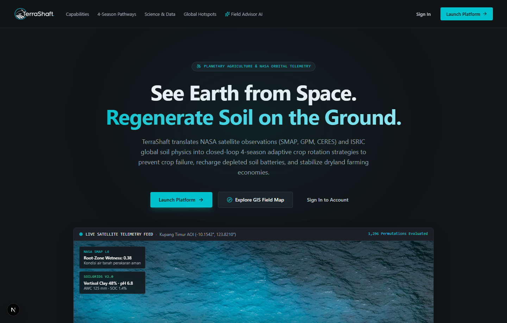
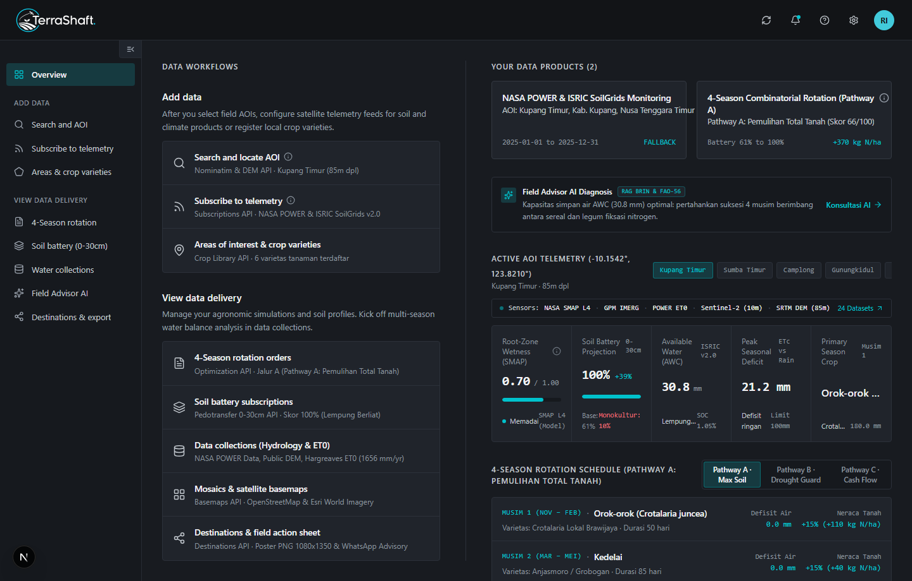
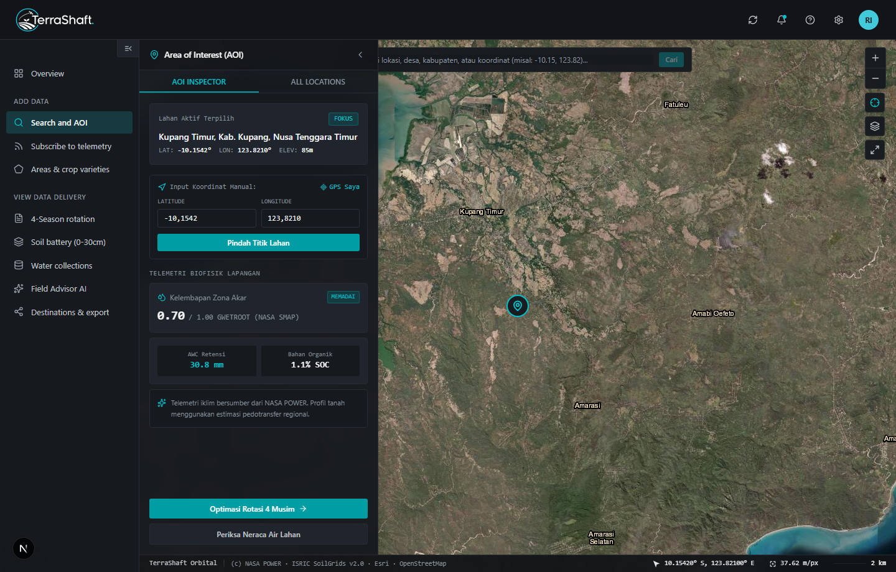
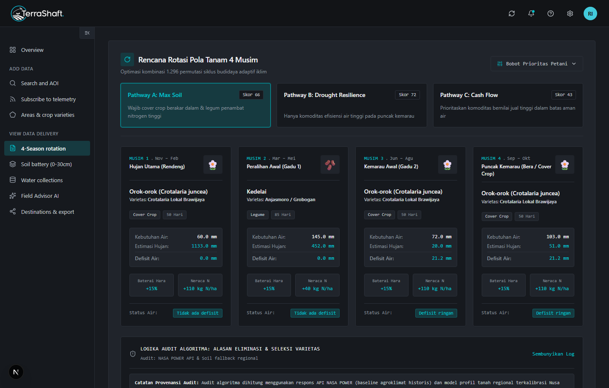
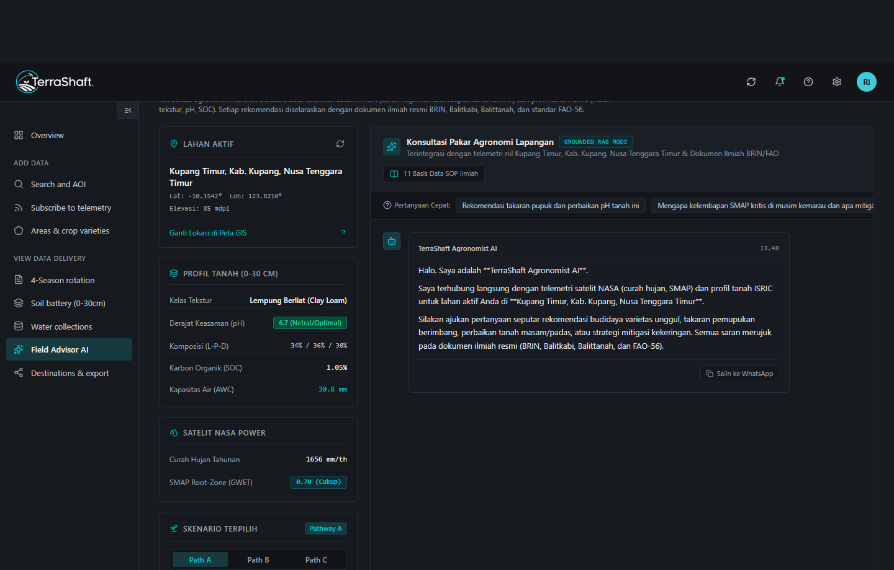
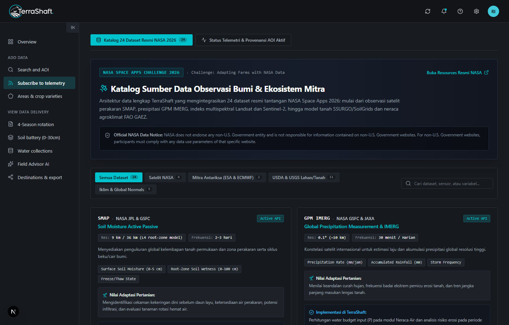

<div align="center">

[](./README.md)
[](./README.id.md)

</div>

# TerraShaft (TerraRotate)

**Adaptive Crop Rotation & Soil Regeneration Decision-Support Engine**

TerraShaft is a web application designed to help farmers and Agricultural Extension Officers (*Penyuluh Pertanian Lapangan* / PPL) build adaptive crop rotation scenarios based on satellite observations, weather data, soil moisture, topography, soil characteristics, and local agricultural context.

The system transforms complex geospatial data into easy-to-understand crop rotation recommendations, complete with water requirement estimates, soil health indicators, drought risk assessments, crop alternatives, and the scientific rationale behind each recommendation.

> **Important Note:** TerraShaft is a decision-support system. It does not replace direct in-situ soil measurements, agricultural extension officers, agronomists, or farmer judgment. Values such as water demand, nitrogen contribution, and the Soil Battery Index are model estimates that carry underlying assumptions and uncertainties.

---

## Table of Contents

- [Application Screenshots](#application-screenshots)
- [Background](#background)
- [Solution](#solution)
- [13 Dataset Sources, References, and Active System Roles](#13-dataset-sources-references-and-active-system-roles)
- [Global Agroecological Zoning, Cultivar Localization & i18n](#global-agroecological-zoning-cultivar-localization--i18n)
- [Geographic Coverage and Dataset Strategy](#geographic-coverage-and-dataset-strategy)
- [System Workflow](#system-workflow)
- [Key Features](#key-features)
- [Methodology and Assumptions](#methodology-and-assumptions)
- [Data Provenance](#data-provenance)
- [Technology Architecture](#technology-architecture)
- [Limitations](#limitations)
- [Running the Project](#running-the-project)
- [Citations and Data Sources](#citations-and-data-sources)
- [Team](#team)
- [License](#license)

---

## Application Screenshots

### 1. Landing Page (`/landing`)

*Introduction to the TerraShaft geospatial intelligence platform bridging NASA POWER and ISRIC SoilGrids telemetry with climate-adaptive crop rotation planning.*

### 2. Executive Overview & Satellite Telemetry Dashboard (`/overview`)

*Active-plot telemetry summary (NASA POWER `GWETROOT` root-zone wetness indicator, NASA POWER `PRECTOTCORR` precipitation, ISRIC SoilGrids v2.0 topsoil fractions, Available Water Capacity $AWC$, global AEZ profile, and 3-pathway rotation comparison).*

### 3. Interactive GIS Field Explorer (`/field-map`)

*Leaflet-based spatial explorer featuring Indonesian dryland & global reference presets, location geocoding (`/api/geocode`), and interactive plot selection.*

### 4. 4-Season Crop Rotation Planner & Radar Comparison (`/rotation-planner`)

*Combinatorial evaluation of $6^4 = 1,296$ rotation sequences across three optimization pathways (Pathway A: Soil Regeneration, Pathway B: Drought Resilience, Pathway C: Cash-Flow Optimized) with localized cultivars and Algorithmic Audit Logs.*

### 5. RAG-Powered AI Field Advisor (`/field-advisor`)

*Contextual agronomic assistant combining active field telemetry and AEZ zoning with local curated knowledge bases (BRIN, Balittanah, Ministry of Agriculture, FAO-56) and explicit citations.*

### 6. Data Provenance Transparency & Scientific Resource Catalog (`/data-sources`)

*Transparent API provenance tracking (`source`, `fetchedAt`, `observationPeriod`, cache/fallback state) alongside a structured 13-item catalog categorized by actual implementation status (`Live API`, `Static Local Registry`, `Knowledge Base`, `Reference Standard`, `Planned Integration`).*

---

## Background

Agriculture in dryland regions and rainfed food-production centers faces several critical challenges:

- Shifting rainfall patterns make historical planting calendars increasingly difficult to rely on without adjustment.
- Monoculture farming can accelerate nutrient depletion, pest and disease pressure, and vulnerability to water stress.
- Surface soil conditions do not always reflect the moisture available around the root zone.
- Satellite, climate, and soil datasets are available in massive volumes but are difficult to translate into actionable field decisions.
- Agronomic recommendations must simultaneously account for technical factors, economics, water availability, and local conditions.

TerraShaft is designed to bridge Earth observation data with practical, understandable agricultural action.

---

## Solution

TerraShaft combines four analytical layers:

1. **Climate & root-zone observations:** daily `PRECTOTCORR` precipitation, temperature, solar radiation, and model-assimilated root-zone wetness indicator (`GWETROOT`) from NASA POWER.
2. **Environmental & AEZ profiling:** reference evapotranspiration ($ET_0$), elevation, dry-season duration, GDD, hemisphere, and agroecological zone classification (`AgroecologicalProfile`).
3. **Soil & agricultural context:** soil texture fractions (sand, silt, clay), pH, soil organic carbon ($SOC$), cation exchange capacity ($CEC$), available water capacity ($AWC$) from ISRIC SoilGrids v2.0, separated species entities, and localized cultivar registry entries.
4. **Decision optimization:** crop filtering based on water constraints, 4-period planting calendars, soil regeneration goals, cross-border cultivar guardrails, and projected net revenue.

The final output presents three ranked rotation pathways (Pathway A, B, and C) rather than a single rigid answer. Each scenario highlights benefits, risks, algorithmic audit logs, cultivar evidence/fallback status, and data provenance.

---

## 13 Dataset Sources, References, and Active System Roles

To prevent overclaiming and clarify exactly what executes in runtime code versus what serves as scientific/knowledge-base context, all 13 catalogued items in `/data-sources` are grouped into **5 explicit implementation statuses**: `Live API`, `Static Local Registry`, `Knowledge Base`, `Reference Standard`, and `Planned Integration`.

| Status Label | Sources | Actual Implementation in Code |
|---|---|---|
| **`Live API`** | NASA POWER (`/api/nasa-climate`), ISRIC SoilGrids v2.0 (`/api/soil-profile`), Open-Meteo Elevation / SRTM DEM + Nominatim (`/api/geocode`) | Actively fetched at runtime via server route proxies with bounded caching & regional failover. |
| **`Static Local Registry`** | `crop_species.json` (6 species) & `cultivars_registry.json` (**23 static cultivar entries** + institutional metadata) | Active in cultivar localization & optimization; **not** connected to external live registration/seed-availability APIs yet. |
| **`Knowledge Base`** | Local RAG documents in `agronomyKnowledgeBase.ts` (BRIN/Balittanah, ECOSTRESS, GEDI) | Textual context retrieved by the AI Field Advisor; no direct ECOSTRESS/GEDI satellite API calls. |
| **`Reference Standard`** | USDA Soil Texture Triangle, FAO-56 & GAEZ v4 literature, GLDAS/ERA5 reanalysis docs | Conceptual formulas & static fallback constants; **no** runtime SSURGO live queries or FAO GAEZ raster layers. |
| **`Planned Integration`** | Direct SMAP API, Direct GPM/IMERG API, Landsat/MODIS/VIIRS indices, Sentinel-2 spectral processing | Documented on roadmap & catalog; no API routes or spectral raster processing in runtime pipeline. |

### Breakdown of the 13 Catalogued Sources

1. **NASA POWER (`Live API`):** Daily agroclimatology (`T2M_MIN`, `T2M_MAX`, `T2M`, `ALLSKY_SFC_SW_DWN`, `PRECTOTCORR`, `GWETROOT`) fetched via `/api/nasa-climate` to calculate $ET_0$, precipitation supply, and root-zone wetness.
2. **ISRIC SoilGrids v2.0 (`Live API`):** Depth-weighted 0–30 cm topsoil properties (`sand`, `silt`, `clay`, `soc`, `phh2o`, `cec`) fetched via `/api/soil-profile` to calculate Available Water Capacity ($AWC$) and soil texture class.
3. **Open-Meteo Elevation / SRTM DEM (`Live API` point elevation | `Planned Integration` slope/runoff rasters):** `/api/geocode` fetches coordinate elevation from Open-Meteo Elevation (SRTM/Copernicus DEM) for AEZ elevation-band classification; gridded slope/runoff calculations are not run at runtime.
4. **NASA SMAP L4 Context (`Live API parameter GWETROOT via NASA POWER` | Direct SMAP API: `Planned Integration`):** TerraShaft does **not** call a direct SMAP API endpoint. Root-zone moisture at runtime uses NASA POWER `GWETROOT` as a model-assimilated root-zone wetness indicator.
5. **NASA GPM / IMERG Context (`Live API parameter PRECTOTCORR via NASA POWER` | Direct GPM/IMERG API: `Planned Integration`):** TerraShaft does **not** have a direct NASA GPM/IMERG integration. Runtime rainfall relies on NASA POWER precipitation parameter `PRECTOTCORR`.
6. **Landsat & MODIS / VIIRS (`Planned Integration` / `Reference Standard`):** Not fetched via API and no NDVI/EVI pixel processing runs in runtime calculations; included as vegetation-monitoring reference context.
7. **Copernicus Sentinel-2 (`Planned Integration` / `Reference Standard`):** `/field-map` displays Leaflet web tiles for spatial orientation; no raw Sentinel-2 10 m multispectral bands or Copernicus API calls are executed.
8. **GLDAS & ECMWF ERA5 (`Reference Standard`):** Land-surface reanalysis background standards; not fetched at runtime (all runtime weather telemetry comes from NASA POWER or calibrated latitude fallbacks).
9. **NASA ECOSTRESS (`Knowledge Base` / `Planned Integration`):** Curated RAG document entry in `agronomyKnowledgeBase.ts` explaining heat-stress & soil-cooling cover crop concepts; no live ECOSTRESS LST API calls.
10. **NASA GEDI LiDAR (`Knowledge Base` / `Planned Integration`):** Curated RAG document entry describing canopy-structure & agroforestry windbreaks; no live GEDI waveform/LiDAR API calls.
11. **Regional Cultivar Registry & BRIN / Extension Knowledge Base (`Static Local Registry` & `Knowledge Base`):** Static JSON registry (`src/data/cultivars_registry.json`) containing **23 curated cultivar entries** across `Indonesia`, `United States`, `Kenya`, `Tanzania / East Africa`, `Uganda`, `India / South Asia`, `Brazil / Latin America`, and `Australia`, plus BRIN/Balittanah RAG docs. Institutional references (`USDA NASS / Land-Grant Extension`, `KALRO / KEPHIS`, `ICAR / IRRI`, `EMBRAPA`, `GRDC`, `BRIN / Balittanah`) are stored as local JSON metadata strings—live endpoints such as `GET /api/cultivars`, `GET /api/cultivar-recommendation`, or `GET /api/evidence` are **not yet implemented**.
12. **FAO GAEZ v4 & FAO-56 (`Reference Standard` & `Knowledge Base`):** FAO-56 informs conceptual $ET_0$/$K_c$ calculations and GAEZ v4 appears in the RAG knowledge base; **FAO GAEZ is not a runtime input** (no GAEZ fetch, raster query, suitability layer, API route, or GAEZ score enters the optimization engine).
13. **USDA Soil Taxonomy & SSURGO / STATSGO2 Reference (`Reference Standard`):** The **USDA Soil Texture Triangle** (`classifySoilTexture`) and NRCS pedological references inform conceptual texture classification and static regional/CONUS fallback constants when ISRIC SoilGrids times out; **there is no live query to SSURGO or STATSGO2**, and runtime soil values originate from ISRIC SoilGrids or calibrated regional failover.

---

## Global Agroecological Zoning, Cultivar Localization & i18n

TerraShaft strictly separates **crop species taxonomy** from **static regional cultivar records** so domestic varieties never leak across borders without verified release mapping:

1. **Separated Taxonomy (`src/data/crop_species.json` vs `src/data/cultivars_registry.json`):** Evaluates 6 base crop species first (*Oryza sativa L.*, *Zea mays L.*, *Glycine max (L.) Merr.*, *Vigna radiata*, *Sorghum bicolor*, *Crotalaria juncea*). The static registry (`23` curated entries) binds each variety to explicit `country_or_region_of_release`, `allowed_agroecological_zones`, `registration_status`, `evidence_source`, and calibrated `confidence_score`.
2. **Global Agroecological Zoning (`src/lib/agroecologicalZoning.ts`):** Transforms coordinates, elevation, NASA POWER climate telemetry, and ISRIC SoilGrids topsoil fractions into a normalized `AgroecologicalProfile` (country, macro-region, hemisphere, elevation band, dry-season months, annual GDD, photoperiod class, and AEZ class).
3. **Cross-Border Guardrail & Archetype Fallback (`src/lib/cultivarLocalizer.ts`):** Indonesian varieties (Inpago, Bisi-18, Anjasmoro, Vima, Bioguma) are restricted strictly to `ID`. Global coordinates in covered territories (`US`, `KE`, `TZ`, `UG`, `IN`, `BR`, `AU`) resolve static local regional entries when AEZ-compatible, while unmapped territories transparently fall back to a **Species Phenotype Archetype** without fabricating cultivar names, yields, or seed availability.
4. **Bilingual Web App i18n (`en` default / `id` alternative):** Built with `i18next` (`src/locales/en.json` default for demo mode, `src/locales/id.json` alternative). Switching `EN | ID` updates UI text only—telemetry, scientific names, cultivar identities, units, and optimization calculations remain invariant.

---

## Geographic Coverage and Dataset Strategy

TerraShaft implements a **Global Core Live APIs + Static Regional Registries** architecture.

### Global Core (Live Runtime APIs Worldwide)

Active backend route proxies operating across Indonesia and global coordinates:

```text
NASA POWER /api/nasa-climate (T2M, T2M_MAX, T2M_MIN, ALLSKY_SFC_SW_DWN, GWETROOT, PRECTOTCORR)
ISRIC SoilGrids 250m v2.0 /api/soil-profile (Sand, Silt, Clay, SOC, pH, CEC 0-30cm)
OpenStreetMap Nominatim + Open-Meteo Elevation /api/geocode (Geocoding & DEM Elevation)
```

### Regional Contexts & Benchmark Presets

- **Indonesia:** Dryland presets (East Kupang, Camplong, East Sumba, Gunungkidul, Indramayu, East Lombok), static `ID` cultivar registry entries, and BRIN/Balittanah RAG documents in Field Advisor.
- **International Benchmarks:** Cross-continental AEZ presets (Central Valley USA, Machakos Kenya, Murray-Darling Australia) backed by static regional cultivar records or transparent Phenotype Archetype fallback, plus the 13-item dataset/reference catalog at `/data-sources`.

---

## System Workflow

```text
Coordinate input / place search / preset selection on map
              ↓
Strict coordinate validation (-90..90 lat, -180..180 lon without silent clamping)
              ↓
Parallel telemetry fetching via Next.js Route Handler proxies:
  • /api/nasa-climate (NASA POWER: T2M, solar irradiance, GWETROOT, PRECTOTCORR)
  • /api/soil-profile (ISRIC SoilGrids v2.0 0–30 cm)
  • /api/geocode (Nominatim + Open-Meteo DEM elevation)
              ↓
Quality control, fill-value masking (-999), & calibrated regional fallback on timeout
              ↓
Global AEZ profiling (agroecologicalZoning.ts) & Static Cultivar / Archetype resolution
              ↓
Computing daily ET0 (Hargreaves-Samani), crop ETc, soil AWC, & Water Balance
              ↓
Combinatorial evaluation of 6^4 = 1,296 4-period rotation sequences → Pathway A, B, & C
              ↓
Generating Algorithmic Audit Logs, Provenance Badges, RAG Field Advisory, & PNG Action Sheet
```

---

## Key Features

### 1. Interactive GIS Map & Dynamic Location Input (`/field-map` & Header)

- Place name search and reverse geocoding (`/api/geocode`).
- Manual GPS coordinate input and interactive Leaflet map pin selection.
- Device geolocation support.
- Built-in presets for Indonesian drylands and global agricultural basins.
- Strict coordinate bounds validation (`-90..90` latitude, `-180..180` longitude) returning HTTP 400 on invalid inputs without silent clamping.

### 2. Multi-Source Climate & Soil Telemetry (`/overview`)

Integrates NASA POWER `GWETROOT` root-zone wetness indicator, `PRECTOTCORR` precipitation, temperature, solar radiation, topsoil physico-chemical properties (USDA texture class, SOC, pH, CEC, AWC), global AEZ profiling (`AgroecologicalProfileCard`), and API provenance metadata.

### 3. Soil Battery Index (`/soil-battery`)

The Soil Battery is a composite heuristic index ($0–100\%$) designed to communicate simulated soil health dynamics and biological nitrogen balance ($\Delta N$ in $\text{kg N/ha}$), not a replacement for laboratory soil testing:

- **Discharging:** Consecutive nutrient-demanding cereal monocultures deplete the Soil Battery score.
- **Charging:** Incorporating nitrogen-fixing legumes (*Glycine max*, *Vigna radiata*) and hardpan-penetrating cover crops (*Crotalaria juncea*) with regionally verified cultivars recharges the Soil Battery index.

### 4. Three Optimal Rotation Scenarios (`/rotation-planner`)

- **Pathway A — Soil Regeneration:** Maximizes Soil Battery recovery, biological nitrogen fixation, and organic biomass return.
- **Pathway B — Drought Resilience:** Disqualifies water-intensive crops during severe deficit windows and prioritizes drought-tolerant species with localized cultivars (or transparent phenotype archetypes).
- **Pathway C — Cash-Flow Optimized:** Maximizes projected net farm revenue while enforcing root-zone water safety constraints.

### 5. Water Balance Chart (`/water-balance`)

Monthly dual-axis comparison between NASA POWER precipitation supply (`PRECTOTCORR`), NASA POWER root-zone wetness indicator (`GWETROOT`), and crop evapotranspiration demand ($ET_c = ET_0 \times K_c$).

### 6. Algorithmic Audit Log

Every recommendation transparently exposes why specific crops were selected or disqualified based on biophysical threshold rules (e.g., $W_{deficit}$ limits or monoculture pest penalties) alongside cultivar evidence and fallback metadata.

### 7. RAG-Powered AI Field Advisor (`/field-advisor`)

Interactive agronomic assistant (`/api/ai/advisor`) combining document retrieval from `agronomyKnowledgeBase.ts` with live climate/soil telemetry and AEZ profiles. Supports user-configured Gemini API keys (via `/settings`) as well as a built-in deterministic offline-capable advisory engine with explicit scientific citations.

### 8. WhatsApp Action Sheet Export (`/action-sheet`)

Renders the 4-season rotation plan and localized cultivars/archetypes into a high-resolution mobile-friendly PNG poster ($1080 \times 1350\text{ px}$) via `html-to-image`, paired with a **High-Contrast Outdoor Mode** for readability under direct sunlight.

---

## Methodology and Assumptions

### 1. Reference Evapotranspiration ($ET_0$)

Computed in `src/lib/evapotranspiration.ts` using the **radiation-calibrated Hargreaves-Samani equation** driven by NASA POWER surface shortwave radiation (`ALLSKY_SFC_SW_DWN`):

```text
Ra_equiv (mm/day) = ALLSKY_SFC_SW_DWN × 0.408
ET0 (mm/day)      = 0.0023 × Ra_equiv × (Tmean + 17.8) × sqrt(max(0.5, Tmax - Tmin))
```

### 2. Crop Water Requirement ($ET_c$)

```text
ETc = Daily_ET0 × Growth_Duration_Days × (Kc_mid × 0.88)
```

### 3. Available Water Capacity ($AWC$) & USDA Texture

Computed in `src/lib/pedotransfer.ts` for the 0–30 cm topsoil layer from ISRIC SoilGrids v2.0 particle-size fractions and Soil Organic Carbon ($SOC$), with texture classes referencing the conceptual USDA Soil Texture Triangle:

```text
AWC (mm / 30cm) = 0.15 × Sand% + 0.35 × Silt% + 0.40 × Clay% + 1.2 × SOC%
```

### 4. Economic & Nitrogen Balance Estimates

Projected net revenue and biological nitrogen contributions ($\text{kg N/ha}$) in `src/lib/optimizationEngine.ts` are model simulations parameterized by local crop species/commodity libraries (`src/data/crops_library.json` & `src/data/crop_species.json`) and should be calibrated with local market prices and field observations.

---

## Data Provenance

Every backend proxy response (`/api/nasa-climate` and `/api/soil-profile`) embeds a strict provenance metadata contract distinguishing live API observations, cached responses, and calibrated regional failovers:

```json
{
  "source": "ISRIC_SOILGRIDS_LIVE",
  "fetchedAt": "2026-11-15T06:00:00.000Z",
  "observationPeriod": "Standard Depth Layer 0-30cm",
  "cached": false,
  "fallbackReason": null
}
```

Supported `source` identifiers in the codebase:

- `NASA_POWER_LIVE` — Live response from the NASA POWER Agroclimatology API.
- `ISRIC_SOILGRIDS_LIVE` — Live response from the ISRIC SoilGrids v2.0 REST API.
- `FALLBACK_CLIMATOLOGY` — Latitude-calibrated regional climatology baseline used when the upstream NASA POWER API times out or is unreachable.
- `REGIONAL_FALLBACK` — Calibrated regional pedological profile used when ISRIC SoilGrids is unreachable or returns masked water/urban pixels.

`fetchedAt` records the network/cache retrieval timestamp and is strictly separated from `observationPeriod` (the physical satellite observation window or soil depth horizon).

---

## Technology Architecture

- **Frontend Framework:** Next.js 16 (App Router, React 19, TypeScript).
- **Styling:** Tailwind CSS v4 (Dark Telemetry Theme & High-Contrast Outdoor Mode).
- **Internationalization (i18n):** `i18next` powering the bilingual web app (`src/locales/en.json` & `src/locales/id.json`) and synchronized documentation (`README.md` & `README.id.md`).
- **Spatial Mapping:** Leaflet with satellite imagery and dark vector basemaps.
- **Data Visualization:** Recharts (Dual-Axis Water Balance Chart & 5-Axis Pathway Radar Comparison).
- **State Management & Offline Persistence:** Zustand + `idb-keyval` + PWA Service Worker.
- **Image Export:** `html-to-image` (client-side $1080 \times 1350\text{ px}$ PNG poster rendering).
- **Backend API Route Handlers:**
  - `/api/nasa-climate` — NASA POWER Agroclimatology proxy (`T2M`, `T2M_MAX`, `T2M_MIN`, `ALLSKY_SFC_SW_DWN`, `PRECTOTCORR`, `GWETROOT`) with bounded in-memory caching (24h TTL) & regional climatology failover.
  - `/api/soil-profile` — ISRIC SoilGrids v2.0 proxy with 0–30 cm depth-weighted aggregation, bounded caching (30d TTL), & static regional soil failover.
  - `/api/geocode` — OpenStreetMap Nominatim & Open-Meteo Elevation (SRTM/Copernicus DEM) proxy.
  - `/api/ai/advisor` — RAG Field Advisor endpoint supporting both Gemini API keys and a deterministic local citation engine.

---

## Limitations

- **Runtime telemetry scope:** Only NASA POWER (`/api/nasa-climate`), ISRIC SoilGrids v2.0 (`/api/soil-profile`), OpenStreetMap Nominatim, and Open-Meteo Elevation (`/api/geocode`) are called via live HTTP APIs. There is **no** direct SMAP API route (root-zone wetness uses NASA POWER `GWETROOT`), **no** direct GPM/IMERG API route (rainfall uses `PRECTOTCORR`), **no** runtime FAO GAEZ or SSURGO/STATSGO2 queries, and **no** runtime spectral/LiDAR ingestion from Landsat, MODIS/VIIRS, Sentinel-2, ECOSTRESS, GEDI, or ERA5/GLDAS.
- **Spatial scale & global models:** NASA POWER (~0.5° / ~50 km) and ISRIC SoilGrids (250 m machine-learning predictions) reflect regional estimates rather than sub-meter in-situ sensors or laboratory soil tests.
- **Static cultivar registry:** `src/data/cultivars_registry.json` holds 23 curated static entries across supported countries/regions with institutional citations stored as local JSON metadata; there are no external live cultivar-registration or commercial seed-availability endpoints (`/api/cultivars`, `/api/cultivar-recommendation`, `/api/evidence`) yet.
- **Simulation outputs:** Crop water demand ($ET_c$), Soil Battery scores, nitrogen balances, and financial projections are heuristic simulation estimates requiring validation by local agronomists or extension officers.

---

## Running the Project

### Prerequisites

- Node.js 20 or newer.
- npm, pnpm, or yarn.

### Installation

```bash
git clone https://github.com/vellumgracia-del/TerraShaft.git
cd TerraShaft
npm install
```

### Environment Variables (Optional)

The application runs out of the box without secret API keys because NASA POWER and ISRIC SoilGrids are open public APIs. To customize upstream timeouts/URLs or configure a server-side Gemini API key for the Field Advisor, create a `.env.local` file:

```text
NASA_POWER_BASE_URL=https://power.larc.nasa.gov/api
ISRIC_SOILGRIDS_BASE_URL=https://rest.isric.org/soilgrids/v2.0
NASA_POWER_TIMEOUT_MS=8000
SOILGRIDS_TIMEOUT_MS=8000
GEMINI_API_KEY=<optional-for-ai-advisor>
```

Never commit `.env.local` or secret keys to version control.

### Running Tests and Development Server

```bash
npm test
npm run lint
npm run dev
```

Open `http://localhost:3000` in your browser.

### Synchronizing Bilingual Documentation (`i18next`)

```bash
npm run i18n:readme
```

### Production Build

```bash
npm run build
npm run start
```

---

## Citations and Data Sources

- **NASA POWER Project:** NASA Langley Research Center (LaRC) Agroclimatology Archive (`T2M`, `ALLSKY_SFC_SW_DWN`, `PRECTOTCORR`, `GWETROOT`).
- **ISRIC — World Soil Information:** SoilGrids 250m v2.0 (*Poggio et al., 2021*).
- **Open-Meteo Elevation & OpenStreetMap Nominatim:** Elevation DEM & forward/reverse geocoding APIs.
- **Reference Standards (Conceptual & Knowledge Base):** FAO Irrigation and Drainage Paper No. 56 (*Allen et al., 1998*), FAO GAEZ v4, USDA Soil Taxonomy / NRCS Soil Texture Triangle, NASA SMAP L4 / GPM / ECOSTRESS / GEDI / Landsat / Sentinel-2 / ERA5 / GLDAS literature, and regional agronomic references (BRIN, Balittanah, Kementan, USDA NASS/Extension, KALRO/KEPHIS, ICAR/IRRI, EMBRAPA, GRDC).

---

## Team

- **Zulfa Fahmiy Al Murtadlo** ([@varosaghasi](https://github.com/varosaghasi)) — Team Owner
- **Mohammad Arga** ([@rifaldhi](https://github.com/rifaldhi))
- **Moch. Hafidz Zawawi** ([@zawacaprio](https://github.com/zawacaprio))
- **Stiven Josh Peter Siburian** ([@stevenjoshburian](https://github.com/stevenjoshburian))
- **Ravi Arnan Irianto** ([@raviarnan](https://github.com/raviarnan))

---

## License

Developed for sustainable agricultural research, education, and innovation (NASA Space Apps Challenge). Satellite, soil, and agroclimatological data attributions follow the open-access terms of their respective providers (NASA Earthdata, ISRIC SoilGrids CC-BY 4.0, FAO, and BRIN/Kementan).

© 2026 TerraShaft Team — Built for resilient agriculture and space-to-field impact.
